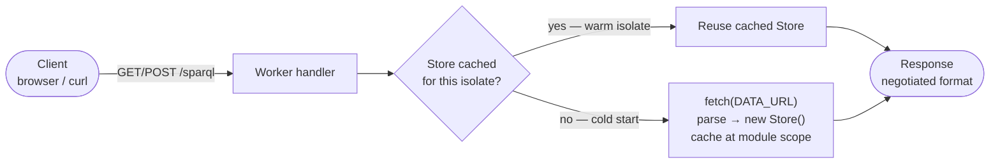
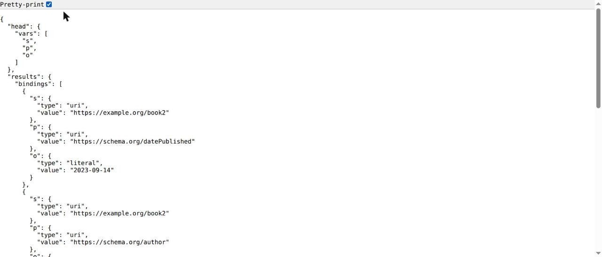
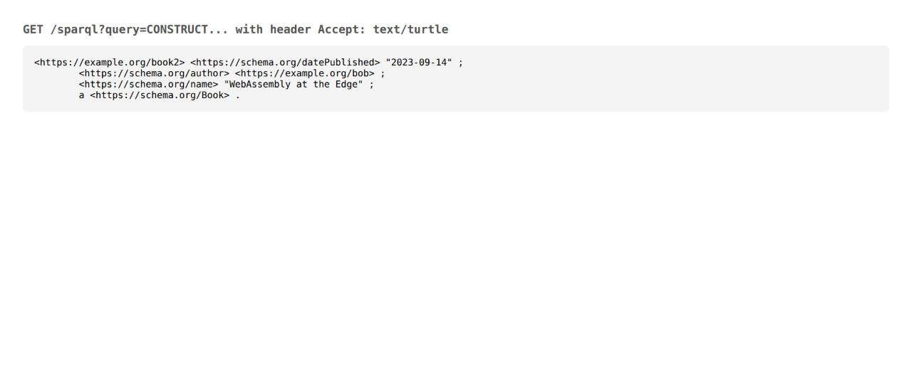
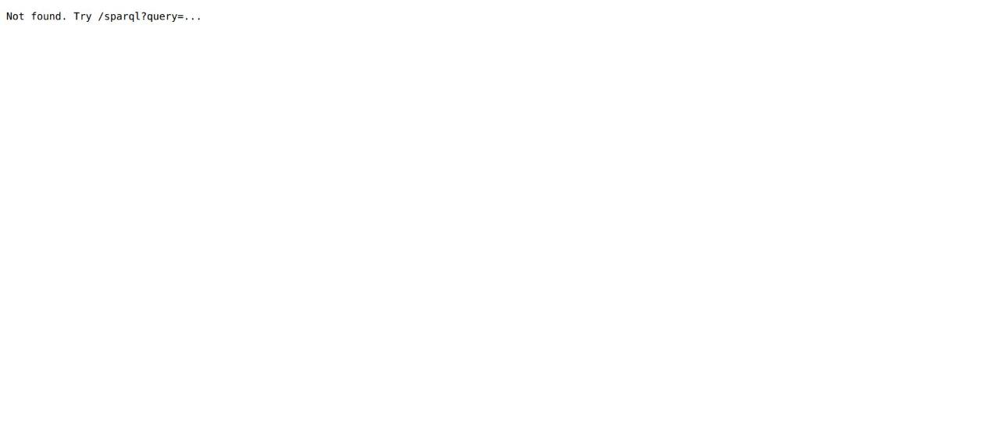
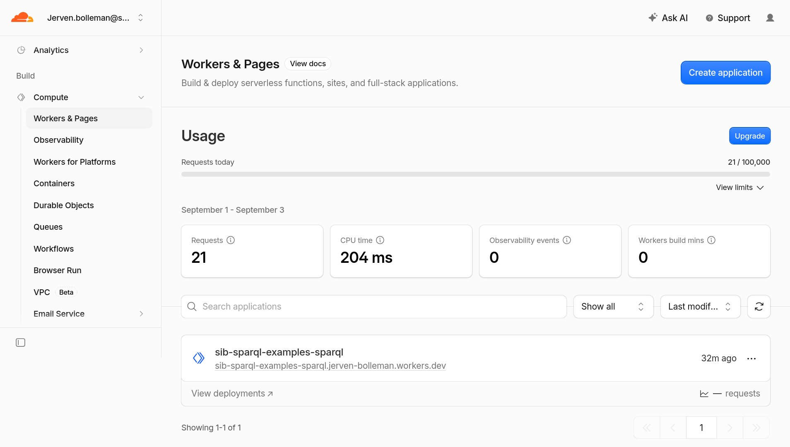
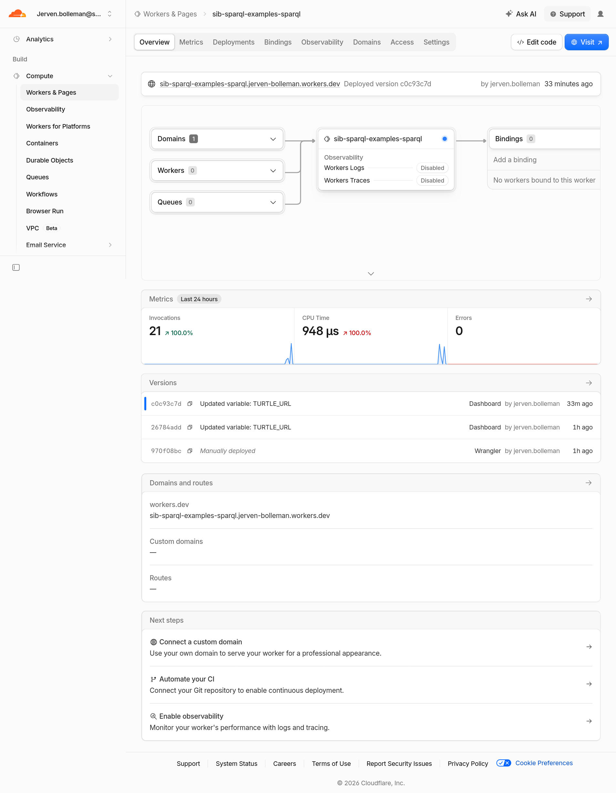
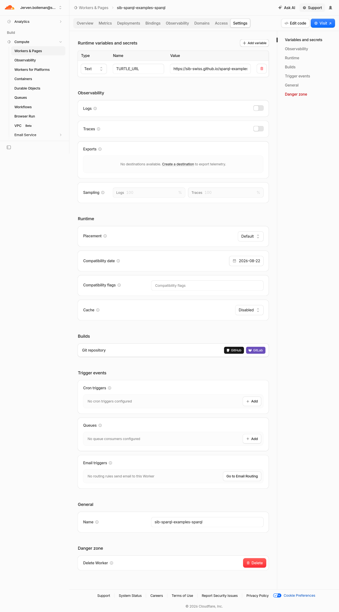

# SPARQL at the edge

A walkthrough of `oxigraph-cloudflare-webworker`: a Cloudflare Worker that
fetches an RDF file (Turtle, JSON-LD, RDF/XML and more), loads it into an in-memory [Oxigraph](https://github.com/oxigraph/oxigraph)
store compiled to WebAssembly, and serves it as a read-only SPARQL 1.1
endpoint — no origin server, no database, just a static file and an edge
isolate. Every response and command below was captured from a real local run
of the worker; the dashboard screenshots are from a real deployment.

## How it works

Three things make this worker possible, and they're worth knowing before you
touch the code:

- **The wasm is bundled, not fetched.** Oxigraph's `web` build normally
  fetches its `.wasm` file relative to `import.meta.url`, which doesn't
  resolve inside a bundled Worker. `src/store.ts` instead imports
  `web_bg.wasm` directly — Wrangler's bundler turns that import into a
  `WebAssembly.Module` automatically — and hands it to `initSync()`, so
  there's no wasm fetch at request time.
- **The store is loaded once per isolate.** The first request a Worker
  isolate handles fetches `env.DATA_URL`, parses it (Turtle or JSON-LD), and caches
  the resulting `Store` at module scope. Every later request that isolate
  handles reuses it. A failed fetch is *not* cached, so a transient network
  error doesn't permanently break that isolate.
- **It's read-only, on purpose.** There's no SPARQL Update support. This is
  a public, unauthenticated endpoint serving data it doesn't own — write
  access has no place here.



`src/store.ts` caches the loaded `Store` at module scope. A cold isolate
takes the bottom path — fetch, parse, cache — every later request on that
same isolate takes the direct path along the top.

## Install & configure

Clone the repo, then install dependencies:

```sh
npm install
```

Open `wrangler.jsonc` and point `vars.DATA_URL` at your own RDF file
(Turtle, JSON-LD, RDF/XML, N-Triples, N-Quads, TriG or N3), optionally
gzipped. The format and the `Accept` header sent for
it follow the file extension unless you set `DATA_FORMAT` or `DATA_ACCEPT`
(see the README). It ships pointing at a placeholder Turtle file:

```jsonc
{
  "name": "oxigraph-cloudflare-webworker",
  "main": "src/index.ts",
  "vars": {
    // Replace with the URL of your own static data file
    "DATA_URL": "https://example.com/data.ttl",
    // Empty: go by the file extension. Or a media type such as
    // "text/turtle" or "application/n-triples"
    "DATA_FORMAT": "",
    // Empty: ask for that format
    "DATA_ACCEPT": ""
  }
}
```

Then regenerate the generated type declarations so `Env` matches:

```sh
npm run cf-typegen
```

## Run it locally

Start the dev server:

```sh
npm run dev
```

Wrangler boots a local Workers runtime and prints where it's listening once
it's ready:

```
 ⛅️ wrangler 4.128.0
────────────────────
[wrangler:info] Ready on http://localhost:8787
```

> **Tip:** To point a local run at a different data file without editing
> `wrangler.jsonc`, pass `--var` instead:
> `npx wrangler dev --var DATA_URL:http://localhost:8793/sample.ttl`. That's
> how the screenshots below were produced — against a small local Turtle
> file describing two people and two books. A `.jsonld` file works the same
> way.

## Query it

The endpoint lives at `/sparql` and speaks the
[SPARQL 1.1 Protocol](https://www.w3.org/TR/sparql11-protocol/): `GET` or
`POST` with a `query` parameter, or `POST` with a raw body of content type
`application/sparql-query`. A plain `GET` with the query URL-encoded in the
query string is the simplest way to try it — even straight in a browser
address bar:

`localhost:8787/sparql?query=SELECT+%3Fs+%3Fp+%3Fo+WHERE+%7B+%3Fs+%3Fp+%3Fo+%7D+LIMIT+5`



The same query from a terminal:

```sh
curl "http://localhost:8787/sparql?query=SELECT+%3Fs+%3Fp+%3Fo+WHERE+%7B+%3Fs+%3Fp+%3Fo+%7D"
```

`POST` works the same way, either as a form field or as a raw SPARQL body —
useful once a query is too long to comfortably fit in a URL:

```sh
curl -X POST -H "Content-Type: application/sparql-query" \
  --data 'ASK { ?s ?p ?o }' \
  http://localhost:8787/sparql
```

## Result formats

There's no hand-rolled serialization here — the `Accept` header is mapped
straight onto Oxigraph's own `results_format` query option
(`src/content-negotiation.ts`), and Oxigraph produces the bytes. That gives
`SELECT`/`ASK` queries the SPARQL results formats, and
`CONSTRUCT`/`DESCRIBE` the RDF graph formats:

| Accept header                       | Applies to             | Produces                    |
| ------------------------------------ | ----------------------- | ---------------------------- |
| `application/sparql-results+json`    | SELECT / ASK            | SPARQL JSON (default)        |
| `application/sparql-results+xml`     | SELECT / ASK            | SPARQL XML                   |
| `text/csv`                           | SELECT                  | CSV                          |
| `text/tab-separated-values`          | SELECT                  | TSV                          |
| `text/turtle`                        | CONSTRUCT / DESCRIBE     | Turtle                       |
| `application/n-triples`              | CONSTRUCT / DESCRIBE     | N-Triples                    |
| `application/n-quads`                | CONSTRUCT / DESCRIBE     | N-Quads                      |
| `application/trig`                   | CONSTRUCT / DESCRIBE     | TriG                         |
| `application/rdf+xml`                | CONSTRUCT / DESCRIBE     | RDF/XML                      |

A browser address bar can't set custom headers, so here's a `CONSTRUCT`
query run with `fetch()` and `Accept: text/turtle`, rendered straight from
the response body:



The equivalent from a terminal, which can set the header directly:

```sh
curl -H "Accept: text/turtle" \
  "http://localhost:8787/sparql?query=CONSTRUCT+%7B+%3Fs+%3Fp+%3Fo+%7D+WHERE+%7B+%3Fs+%3Fp+%3Fo+%7D"
```

## Errors

The worker responds with plain-text errors and ordinary HTTP status codes:

- `400` — no `query` was given, or the SPARQL failed to parse.
- `404` — any path other than `/sparql`.
- `502` — `DATA_URL`, or a remote JSON-LD context it uses, couldn't be
  fetched or parsed (bad URL, origin down, etc.).



**Note:** `OPTIONS` requests always succeed with just the CORS headers
attached — that's what lets a browser page on another origin call this
endpoint at all (`Access-Control-Allow-Origin: *` is set on every response).

## Run the tests

The test suite runs the real Workers runtime via
[`@cloudflare/vitest-pool-workers`](https://developers.cloudflare.com/workers/testing/vitest-integration/)
— no network access needed, since the fixture data is loaded from `data:`
URLs instead of a real `DATA_URL`:

```sh
npm test
```

It covers SELECT as JSON, ASK, POST with an `application/sparql-query` body,
CONSTRUCT as Turtle, and the 400/404 error paths — the same requests this
tutorial just made by hand — plus loading JSON-LD with a remote `@context`.

## Deploy

```sh
npm run deploy
```

Once it finishes, the worker shows up in the Cloudflare dashboard under
**Workers & Pages**, alongside its request count and CPU time for the day:



Opening it shows the worker's own overview: its live URL, the deployment
that's currently active, and recent versions — each one tagged with what
changed:



By default `npm run deploy` runs against whatever account `wrangler login`
last authenticated — an OAuth grant covering every Cloudflare product on the
account, not just what this worker needs. This project has no bindings
besides a plain var and no custom route, so the actual minimum permission is
a single scope. To use it instead of a full OAuth session:

1. At <https://dash.cloudflare.com/profile/api-tokens>, choose **Create
   Custom Token**.
2. Grant only **Account → Workers Scripts → Edit**, scoped under **Account
   Resources** to the one account this worker deploys to.
3. Export the token and deploy with it:

   ```sh
   export CLOUDFLARE_API_TOKEN=<the token>
   # only needed if the token can't infer a single account:
   export CLOUDFLARE_ACCOUNT_ID=<your account id>
   npm run deploy
   ```

Adding a KV namespace, D1 database, R2 bucket, or a custom route later means
adding the matching permission group to the token — `Workers Scripts:Edit`
alone won't cover those.

> **Tip:** `DATA_URL` can also be changed directly from the dashboard,
> without redeploying from your machine — under the worker's **Settings →
> Variables and secrets**, edit the value and save. That publishes a new
> version immediately.



*This screenshot predates the rename of `TURTLE_URL` to `DATA_URL`; a
current deployment lists `DATA_URL`, `DATA_FORMAT` and `DATA_ACCEPT`
instead.*

## More endpoints from one codebase

To serve another dataset, create a separately named Worker in one step:

```sh
npm run new-worker -- people https://example.org/people.jsonld
```

That writes `workers/people.jsonc` (this repo's code, with its own name and
data URL) and deploys it, which creates the Worker on Cloudflare. See the
README for the options.

## Limitations

- **Read-only.** No SPARQL Update — by design, not as a missing feature.
- **One dataset per worker, fixed at `DATA_URL`.** It isn't re-fetched
  once an isolate has loaded it; updating the source data means redeploying
  or waiting for isolates to recycle.
- **CORS is wide open.** `Access-Control-Allow-Origin: *`, matching how most
  public SPARQL endpoints behave. Tighten `CORS_HEADERS` in `src/index.ts`
  if that's not right for your data.
